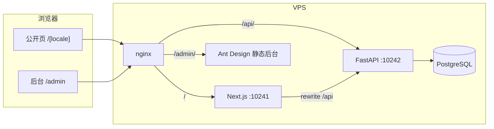

<p align="center">
  <a href="https://github.com/xiongxianzhu/xblog"></a>
  <a href="https://github.com/xiongxianzhu/xblog/blob/main/LICENSE"></a>
</p>

<h1 align="center">xblog</h1>

<p align="center">
  <strong>可自托管的个人博客 Monorepo</strong><br/>
  <sub>FastAPI 后端 · Next.js 前端 · Markdown 写作 · AI 助手 · Giscus 评论 · MIT 开源</sub>
</p>

<p align="center">
  <a href="https://www.python.org/downloads/"></a>
  <a href="https://fastapi.tiangolo.com/"></a>
  <a href="https://nextjs.org/"></a>
  <a href="https://react.dev/"></a>
</p>

<p align="center">
  <a href="https://www.typescriptlang.org/"></a>
  <a href="https://www.postgresql.org/"></a>
  <a href="https://pnpm.io/"></a>
  <a href="https://github.com/astral-sh/uv"></a>
</p>

<p align="center">
  <a href="docs/prd.md"><b>产品需求</b></a>
  &nbsp;·&nbsp;
  <a href="CONTRIBUTING.md"><b>参与贡献</b></a>
  &nbsp;·&nbsp;
  <a href="AGENTS.md"><b>AI 协作说明</b></a>
  &nbsp;·&nbsp;
  <a href="apps/api/README.md"><b>后端文档</b></a>
  &nbsp;·&nbsp;
  <a href="apps/web/README.md"><b>前端文档</b></a>
</p>

<p align="center"><sub>— · — · —</sub></p>

---

## 目录

- [特性](#特性)
- [架构一览](#架构一览)
- [快速开始](#快速开始)
- [技术栈](#技术栈)
- [仓库结构](#仓库结构)
- [文档索引](#文档索引)
- [参与贡献](#参与贡献)
- [生产部署](#生产部署)
- [故障排查](#故障排查)

---

## 特性

| | 能力 | 说明 |
|:---:|:---|:---|
| ✍️ | **在线写作** | Markdown 编辑；**保存草稿 / 发布** 固定底栏；列表页可一键发布草稿 |
| 🖼 | **文章封面** | 本地上传或外链 URL；列表/详情 4:3 展示；未保存时前端即时清理 + 服务端 cron 兜底 |
| 🔗 | **友链** | LOGO 外链/本地上传、简介；公开页展示 LOGO，不显示 URL 文本 |
| 📑 | **阅读体验** | 详情页玻璃正文区、固定目录（TOC）、代码块语言标签、标签归档（中文 slug） |
| 🤖 | **AI 写作助手** | Composer 多 Skill、`/` 唤起、快捷按钮；选区润色、对话改稿、全文生成；SSE 流式 |
| 🌐 | **多语言** | 公开站 `zh-CN` / `zh-TW` / `en`（next-intl）；后台文案 cookie 切换 |
| 🔍 | **SEO 友好** | SSR/ISR、sitemap、RSS、结构化 metadata |
| 🎨 | **双主题体系** | 公开站 7 款 palette + 站点品牌（名称/副标题/LOGO/备案号）；后台 UI 主题（localStorage） |
| 🔐 | **灵活登录** | 用户名密码 · 短信验证码 · GitHub/微信 OAuth；**Turnstile** 人机验证（可开关） |
| 🖥 | **管理后台** | 可折叠侧栏、2px 扁平风、审计日志 API、分页组件、头像与设置 |
| 💬 | **Giscus 评论** | 文章详情 GitHub Discussions；iframe 外层 wrapper 对齐宽度（env 配置，可选） |
| 🏠 | **自托管** | nginx + systemd + PostgreSQL，数据在自己手里 |
| 🤝 | **开源协作** | CONTRIBUTING、Git 工作流、Issue/PR 模板、`llms.txt` |
| 📜 | **MIT 开源** | 可 fork、可改、可部署 |

---

## 架构一览



<p align="center"><sub><b>同域路由</b>：/ → Next.js · /admin/ → 静态后台 · /api/ → FastAPI</sub></p>

---

## 快速开始

### 前置

| Python | uv | Node.js | pnpm | PostgreSQL |
|:------:|:--:|:-------:|:----:|:----------:|
| 3.14 系列 | uv | 26.13.0 LTS | 12.16.1 | 独立 PostgreSQL |

### 1 · 克隆

```bash
git clone git@github.com:xiongxianzhu/xblog.git
cd xblog
```

### 2 · 后端

```bash
cd apps/api
make install && make setup
# 编辑 .env：SECRET_KEY、DATABASE_URL
make migrate && make dev
```

<p align="center">→ API 文档：<a href="http://127.0.0.1:10242/docs"><code>http://127.0.0.1:10242/docs</code></a></p>

### 3 · 前端

在仓库根目录统一安装，两端分别启动：

```bash
pnpm install --frozen-lockfile
pnpm dev:web
# 另一个终端
pnpm dev:admin
```

公开站访问 <http://localhost:10241>，管理端访问 <http://localhost:10243/admin/>。两端可分别开发；跨端导航、Cookie 和 OAuth 需在同域部署入口验收。生产使用唯一配置 [xblog.conf](deploy/nginx/xblog.conf)，见 [部署文档](docs/deployment.md)。

质量检查在根目录执行 `pnpm check`、`pnpm typecheck`、`pnpm test`、`pnpm build`；Biome 负责格式与 lint，TypeScript 独立检查。

### 4 · 可选：Giscus 评论

```bash
cd apps/web
cp .env.example .env
# 填写 NEXT_PUBLIC_GISCUS_*（见 https://giscus.app/zh-CN）
pnpm dev
```

仓库需启用 GitHub **Discussions**。未配置时文章页会显示引导文案。评论 iframe 由 `components/giscus.tsx` 注入 wrapper，`globals.css` 中 `[data-site-shell] .giscus > div` 控制宽度对齐。

---

## 技术栈

### 后端 `apps/api/`

| 类别 | 技术 |
|------|------|
| 语言 | Python 3.14 |
| 框架 | FastAPI |
| ORM | SQLModel · Alembic |
| 认证 | Cookie + JWT · bcrypt · 短信 · OAuth |
| 数据库 | PostgreSQL |
| 工具链 | uv · ruff · mypy · pytest |

脚手架：[create-fastapi](https://github.com/xiongxianzhu/create-fastapi)

### 前端 `apps/web/`

| 类别 | 技术 |
|------|------|
| 框架 | Next.js 16 · React 19 · TS |
| 国际化 | next-intl · `app/[locale]/` · `messages/*.json` |
| 样式 | Tailwind CSS 4 · shadcn/ui |
| 公开页 | RSC + ISR |
| 后台 | Client Components · SWR · AI 内嵌面板 |
| 评论 | Giscus（GitHub Discussions） |

<p align="center"><sub><b>部署</b>：nginx · uvicorn · next start · systemd</sub></p>

---

## 仓库结构

```text
xblog/
├── apps/
│   ├── api/          # FastAPI、Alembic、uv.lock、tests
│   ├── web/          # Next.js 公开站、ISR、fonts
│   └── admin/        # Vite + Ant Design 管理端
├── packages/contracts/ # 共享业务类型
├── deploy/           # nginx、systemd
├── docs/
├── package.json
├── pnpm-workspace.yaml
├── pnpm-lock.yaml
└── biome.json
```

---

## 文档索引

| 文档 | 适合谁 | 内容 |
|------|--------|------|
| [AGENTS.md](AGENTS.md) | AI / 新贡献者 | 目录约定、环境变量、主题 ISR、Git 规范 |
| [llms.txt](llms.txt) | LLM / AI 工具 | 仓库导航索引（llms.txt 规范，链到核心文档与入口代码） |
| [docs/prd.md](docs/prd.md) | 产品 / 架构 | 需求、验收标准、技术决策 |
| [docs/superpowers/](docs/superpowers/specs/) | 功能设计 | AI Composer、登录防护、上传清理等 spec/plan |
| [apps/api/README.md](apps/api/README.md) | 后端开发 | API、迁移、`cleanup-uploads`、部署、排错 |
| [apps/web/README.md](apps/web/README.md) | 公开站 | 路由、主题、构建、排错 |
| [apps/admin/README.md](apps/admin/README.md) | 管理端 | Ant Design、认证、编辑与静态部署 |
| [deploy/systemd/README.md](deploy/systemd/README.md) | 运维 | 生产进程守护 |
| [CONTRIBUTING.md](CONTRIBUTING.md) | 贡献者 | 分支、Commit、PR 流程 |
| [docs/git-workflow.md](docs/git-workflow.md) | 维护者 / 贡献者 | Git 协作规范详解 |

---

## 参与贡献

欢迎 Issue、文档改进与 Pull Request。

1. 阅读 [CONTRIBUTING.md](CONTRIBUTING.md) 了解分支与 Commit 规范
2. 详细流程见 [docs/git-workflow.md](docs/git-workflow.md)
3. 提 PR 前请运行 `make check`（backend）与 `pnpm check && pnpm build`（frontend）

```bash
git checkout -b feat/your-feature main
# 开发…
git commit -m "feat: 你的改动说明"
git push -u origin feat/your-feature
```

然后在 GitHub 发起 Pull Request。

---

## 生产部署

```text
① 配置 apps/api/.env + apps/web/.env（含 REVALIDATE_SECRET）
② uv sync --frozen --no-dev && alembic upgrade head
③ pnpm --filter @xblog/web build → xblog-web.service
④ pnpm --filter @xblog/admin build → apps/admin/dist（nginx 静态托管）
⑤ nginx：/ → :10241，/admin/ → apps/admin/dist，/api/ → :10242
⑥ 可选：cron 每小时 `cleanup-uploads`（见 apps/api/README.md）
```

<p align="center">详细步骤 → <a href="deploy/systemd/README.md"><b>deploy/systemd/README.md</b></a></p>

---

## 故障排查

| 现象 | 可能原因 | 处理 |
|------|----------|------|
| 公开页主题不生效 | `REVALIDATE_SECRET` 未配或缓存 | 对齐前后端密钥；开发环境硬刷新 |
| 评论不显示 | 未配置 `NEXT_PUBLIC_GISCUS_*` | 复制 `apps/web/.env.example` → `.env` 并重启 |
| 封面/正文更新延迟 | ISR 缓存 | 生产配置 `REVALIDATE_SECRET`；开发环境硬刷新 |
| 标签页 URL 乱码 | 中文 slug 已编码 | 正常；页面用 `decodeRouteParam` 解码并显示 `tag.name` |
| 封面/LOGO 预览 404 | 后端未启动或上传目录无权限 | `make dev`；确认 `uploads/covers/`、`uploads/link-logos/` 可写 |
| 关浏览器后磁盘残留上传 | 未保存的本地上传 | 前端 `pending-upload-cleanup.ts` 即时删；生产配置 `cleanup-uploads` cron（见 backend README） |
| 登录需人机验证 | Turnstile 已启用 | 配置 `TURNSTILE_*` / `NEXT_PUBLIC_TURNSTILE_SITE_KEY`；后台 **设置 → 登录方式** 可开关 |
| 前端 API 404 | 后端未启动 / `BACKEND_URL` 错误 | `make dev` + 检查 `apps/web/.env` |
| `/zh-TW/admin` 404 | 后台不应带 locale 前缀 | 访问 `/admin`；`proxy.ts` 会重定向 |
| 后台切换语言无效 | cookie 未写入 | 确认 `locale-switcher` + 刷新页面 |
| 迁移失败 | PostgreSQL 未就绪 | 检查 `DATABASE_URL` |

<p align="center">主题相关 → <a href="AGENTS.md#-主题系统易踩坑"><b>AGENTS.md · 主题系统</b></a></p>

---

<p align="center">
  <sub><b>License</b> · <a href="LICENSE">MIT</a></sub>
</p>
